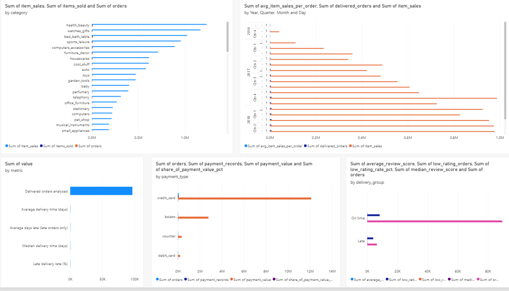

# Olist E-Commerce Sales & Customer Experience Analysis

## Project overview

This project analyzes historical Olist marketplace data to explore sales, product categories, delivery performance, customer reviews, and payment methods.

**Business question:** What patterns in Olist’s sales and customer experience could help the business improve?

## Dataset

The project uses the [Brazilian E-Commerce Public Dataset by Olist on Kaggle](https://www.kaggle.com/datasets/olistbr/brazilian-ecommerce). It contains anonymized marketplace data from 2016–2018.

The analysis uses the orders, order items, products, category translations, reviews, and payments tables.

## Tools

- Python
- Jupyter Notebook in VS Code
- pandas
- Matplotlib

## Analysis

The notebook explores:

- Delivery time and late-delivery rates
- The relationship between delivery timing and review scores
- Item sales by product category
- Monthly item sales and delivered order counts
- Recorded payment value by payment method

## Key findings

- Delivered orders with usable delivery dates took an average of 12.09 days to arrive. About 6.77% arrived after the estimated date.
- Among reviewed delivered orders, 62.36% of late orders received a 1–2 star rating, compared with 9.23% of on-time orders. This is an association, not proof of cause and effect.
- Health and beauty had the highest item sales among product categories, at about 1.23 million in the dataset’s price units.
- Monthly item sales peaked in November 2017, driven mainly by more delivered orders.
- Credit cards accounted for 78.46% of recorded payment value, followed by boleto at 17.96%.

## Recommendations

- Investigate what contributes to late deliveries and monitor delivery performance.
- Keep customers updated when an order may arrive later than estimated.
- Plan fulfillment capacity carefully for periods with higher order volumes.
- Continue supporting the payment methods customers use most.

## Power BI dashboard

The one-page Power BI report summarizes product category sales, monthly sales trends, payment methods, delivery performance, and customer reviews.

The report file is saved at `dashboard/olist_ecommerce_dashboard.pbix`. It uses the summary CSV files in `data/processed/`.

## Limitations

- The dataset covers 2016–2018, so these findings describe historical activity, not Olist’s current performance.
- Item sales are calculated from item prices and exclude freight. Payment value is a separate measure.
- Monthly sales are based on delivered orders, and the first or last months in the dataset may be incomplete.
- The relationship between late delivery and low reviews does not establish causation.

## How to run

1. Download and extract the dataset from Kaggle into `data/raw/`.
2. Open `notebooks/01_data_overview.ipynb` in VS Code.
3. Select the project’s `.venv` Python environment as the notebook kernel.
4. Run the notebook cells from top to bottom.

